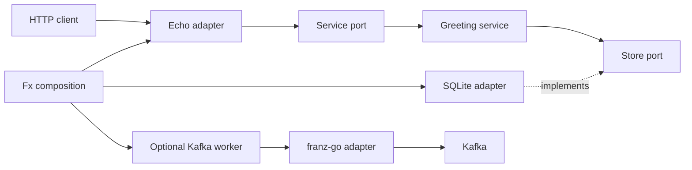

# Architecture

The `greeting` package owns the `Greeting` entity, validation, service operations, and the outbound `Store` port. The SQLite adapter implements that port with a private GORM row model and SQLite autoincrement IDs. The HTTP adapter depends on the service operations and owns routes, JSON validation, DTOs, and error translation. `internal/app` composes providers with Fx and coordinates startup and shutdown. `cmd/server` loads optional Kafka configuration with koanf and handles process signals and exit status. `kafka.enabled` defaults to false. Enabled Kafka runs inside the same Fx application.

The core imports only the standard library. The HTTP adapter owns its inbound interface, and the core owns the outbound storage interface. Both adapters depend on the core. `internal/app` owns Fx imports. `internal/server` owns HTTP timeouts, listener acquisition, graceful shutdown, and Zap server events. The same Zap logger receives application, HTTP, and Fx events.

The service uses `string` for message values instead of a separate message alias. Validation trims Unicode whitespace, rejects invalid UTF-8 and empty values, and limits messages to 1,000 Unicode code points. The HTTP boundary accepts one JSON object with a string `message`, limits its full body to 16 KiB, and rejects unknown fields and extra JSON values.

The HTTP server is inert until its Fx start hook binds the configured address. Its stop hook uses Fx's deadline for graceful drain, then force closes connections when the deadline expires. SQLite data defaults to `greetings.db`; `SQLITE_DSN` selects another path. Startup runs a context-aware GORM migration for the private `greetings` table before HTTP starts. Shutdown drains HTTP before closing SQLite. The connection pool is limited to one connection, uses a bounded busy timeout, and enables WAL for file databases. The CGO-backed SQLite driver requires a C compiler.

One Fx lifecycle hook coordinates Kafka, HTTP, SQLite, and logger cleanup because Fx skips later hooks after its context expires. The hook cancels Kafka, force closes HTTP on a drain timeout, joins the serve goroutine, its failure monitor, and Kafka, closes SQLite, then flushes Zap. Fx can return at its deadline before the hook finishes. After startup or startup failure, the runner joins the same cleanup through a coordinator guarded by `sync.Once`. If Fx skipped the hook, the runner executes cleanup with a canceled context to force close HTTP immediately. This preserves the drain budget and finishes resource cleanup before process exit. Forced close cancels request contexts; arbitrary handlers that ignore cancellation can outlive it. A startup gate prevents cleanup from racing resource acquisition or allowing a Kafka launch after shutdown. Kafka uses a process-lifetime context, not Fx's short-lived startup context. Kafka cleanup waits for cooperative handlers and client closure, even beyond Fx's deadline. Unexpected HTTP or Kafka errors request Fx shutdown with a failing exit code. The runner honors both process cancellation and Fx shutdown requests. Routine Fx events use Zap's debug level; failures use error level.

Store operations pass contexts into GORM. Updates issue one parameterized SQL `UPDATE`, and SQLite's `AUTOINCREMENT` prevents deleted IDs from being reused after restart. Values beyond the signed SQLite ID range map to not found to preserve the public uint64 HTTP contract.

Unit tests isolate service rules, storage behavior, and HTTP adaptation using temporary file databases. Tests with the `integration` build tag use real localhost listeners and temporary databases for CRUD, concurrent requests, and graceful draining. Kafka tests use Testcontainers with Confluent Kafka 8.0.0 through rootless Podman and exercise the combined Fx server. `make coverage` runs the race-enabled integration suite across every application package and enforces at least 90 percent weighted statement coverage.
